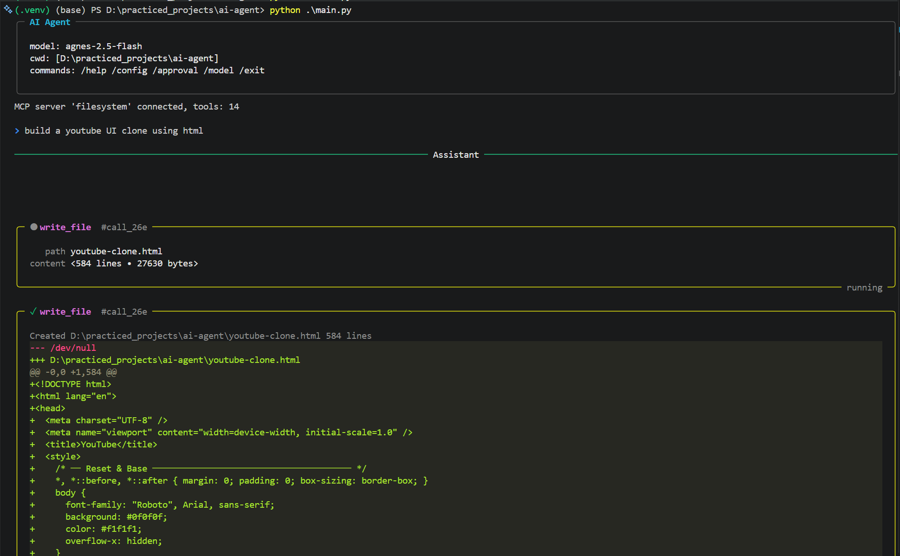

# AI Coding Agent

A terminal-based AI coding assistant built from scratch. This project acts as an autonomous pair programmer, capable of understanding your codebase, executing shell commands, editing files, searching the web, and managing complex multi-step tasks—all within a Terminal User Interface (TUI).

> **Note:** This project was built by following the incredible [AI Coding Agent tutorial by Rivaan Ranawat](https://github.com/RivaanRanawat/ai-coding-agent/tree/main). It serves as a hands-on implementation and exploration of agentic workflows, LLM tool calling, and terminal UI design.

---

## Features

- **Rich Terminal UI**: Beautiful, streaming text interface powered by `rich` with syntax highlighting, tool call tracking, and diff previews.
- **Autonomous Agentic Loop**: Iterative problem-solving with automatic context compaction, loop detection, and token pruning to handle massive codebases without breaking context limits.
- **Comprehensive Toolset**:
  - 📂 **File Operations**: Read, write, and surgically edit files.
  - 🔍 **Codebase Navigation**: Fast regex searching (`grep`), globbing, and directory listing.
  - 💻 **Shell Execution**: Run tests, builds, and system commands with built-in safety guardrails.
  - 🌐 **Web Capabilities**: Search the web (DuckDuckGo) and fetch URL contents for up-to-date documentation.
  - 🧠 **Memory & Todos**: Persistent memory across sessions and task tracking for complex workflows.
- **MCP Integration**: Native support for [Model Context Protocol](https://modelcontextprotocol.io/) servers to extend the agent's capabilities (e.g., secure filesystem access).
- **Safety & Approval System**: Configurable approval policies and strict blocking for dangerous commands (e.g., `rm -rf /`, `mkfs`, fork bombs).
- **Sub-Agents**: Delegate isolated tasks to specialized sub-agents (e.g., Codebase Investigator, Code Reviewer) to save context and improve focus.
- **Session Persistence**: Save, checkpoint, and resume long-running coding sessions seamlessly.
- **Custom Hooks**: Trigger custom Python or Bash scripts before/after agent or tool execution.
- **`AGENTS.md` Support**: Respects repository-specific instructions to enforce coding standards and project rules.
